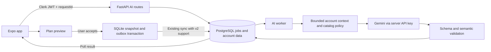

# Personalized Gemini planning and AI coach

Status: proposed design and implementation plan; product implementation has not started.

## User decisions and current state

The user requested a backend/frontend plan using `GEMINI_API_KEY`, then explicitly selected
personalization from each user's profile and workout history through the backend. This replaces the
template-only/no-personal-data architecture and deferred-coach scope in the
[older design](2026-11-06-workout-plan-design.md) for this feature. Other existing work is preserved.

The repository currently has:

- FastAPI, PostgreSQL, Clerk JWT/JWKS authentication, and Pydantic AI. The generic agent explicitly
  constructs an OpenAI model; adding a Gemini key alone does not switch its provider.
- A TypeScript template-generator draft in `frontend/apps/plan-agent`, not a running mobile API.
- `CoachClient` in `frontend/apps/mobile/src/features/coach/coach.ts`, with no implementation or screen.
- Local onboarding calculation through `buildPlan`, a starter `personalize` function, and a separate
  `acceptedPlans` SQLite table. These do not constitute a complete synchronized AI-plan flow.
- Canonical `training_plans` and `training_state` records, currently accepting only `legacySummary`.
- An authenticated `ApiClient` with a 15-second request timeout and an offline workout outbox.

The current workspace contains substantial unrelated changes, including a package rename to `@myos/*`.
Implementation must use the actual manifests, preserve that work, and avoid unrelated renames.

## Intent and scope

An adult can request a plan based on their confirmed preferences and synchronized training history,
preview the result, accept it, reopen it offline, and start a workout from a planned day. The coach can
explain exercises, discuss the saved plan and recent training, and propose a new draft. Applying a
proposal always requires the same explicit preview/accept flow.

V1 includes text coaching, durable asynchronous requests, plan snapshots, account isolation, and web,
Android, and iOS support. Voice, images, autonomous changes, web-search tools, medical/rehabilitation
advice, a second Node backend, and streaming token transport are outside this release.

The first supported programming policy remains the existing `starter-1`: full-body sessions, 1–3
training days/week, four movement roles, two sets, 8–12 repetitions, and 90-second rest. AI personalizes
exercise selection, ordering, history-aware explanations and adjustment proposals within that policy.
It must explain recovery days when requested availability exceeds supported training frequency.
Broader splits, prescriptions, starting-load recommendations, and catalog coverage are a later policy
release, not an implied capability of this MVP. Unsupported constraints return `unavailable`.

## Architecture choices

1. **Recommended: FastAPI + Pydantic AI Google provider.** Reuse the Python backend, authentication,
   persistence and test tooling. Add dedicated training agents and a shared Gemini model factory.
   This is a proposed implementation choice, not a framework preference explicitly supplied by the user.
2. **Direct Google GenAI SDK in FastAPI.** Fewer abstraction layers for a single call, but duplicates
   agent validation, usage accounting and testing conventions already present in Pydantic AI.
3. **Promote the TypeScript LangGraph draft into another runtime service.** Retains the earlier
   orchestration choice, but adds another deployment and cross-service authentication boundary.
   Keep the draft available; it is not a prerequisite for the selected runtime feature.

Use PostgreSQL-backed jobs and HTTP polling for both generation and coach turns. This fits the current
15-second client timeout, avoids keeping a database transaction open during a model call, and permits
resuming a request after navigation or an app restart. Add one worker command/service, without Redis.



## Gemini configuration and data boundary

Backend environment configuration:

```dotenv
GEMINI_API_KEY=
GEMINI_MODEL=gemini-3.8-flash
AI_FITNESS_ENABLED=false
AI_PERSONAL_DATA_ENABLED=false
AI_REQUEST_TIMEOUT_SECONDS=30
AI_RUN_DEADLINE_SECONDS=90
AI_MAX_MODEL_CALLS_PER_RUN=3
AI_PLAN_MAX_OUTPUT_TOKENS=4096
AI_COACH_MAX_OUTPUT_TOKENS=1024
AI_PLAN_REQUESTS_PER_USER_PER_DAY=2
AI_COACH_REQUESTS_PER_USER_PER_DAY=50
AI_GLOBAL_MODEL_CALLS_PER_DAY=500
```

The model and limits above are proposed deployment defaults, not promised account quotas or cost
estimates. Verify the model's availability in the deployed Google project. Construct
`GoogleProvider(api_key=settings.GEMINI_API_KEY)` explicitly; do not depend on environment auto-detection
or allow a client to select a model/key. Add the `google` optional dependency to the existing
`pydantic-ai-slim` dependency, preserving its other extras and checking the installed version's API.
Do not copy OpenAI-specific sampling/thinking settings to Gemini.

The deployment must satisfy Google's terms for personal inputs before `AI_PERSONAL_DATA_ENABLED` is
enabled. Google's terms distinguish Unpaid and Paid Services; Gemini API access through a Cloud
project with an active billing account is covered by Paid Services terms. A user's consent does not
replace this deployment requirement. No task in this plan enables billing or makes a paid model call.

Before the first AI request, show which information is shared and obtain an AI-specific user choice.
Store a versioned consent record server-side and cache the acknowledgement locally. Consent and adult
eligibility are checked before enqueueing and again before a worker sends data. Users can withdraw
consent; cancel queued work and stop future submissions. Already transmitted data cannot be recalled.
Existing manual logging remains available. Users under 18 receive no Gemini-backed feature.

Backend context is built from authenticated account records, not an arbitrary `userId`, system prompt,
or client-supplied conversation history. Include goal, experience, confirmed equipment, days/time,
movement exclusions and bounded training aggregates. Use at most eight weeks, 50 completed workouts,
500 completed sets and the last ten complete coach exchanges. Truncate by a 12,000-token input budget;
preserve system policy and current preferences before dropping the oldest history.

Names, emails, JWTs, account identifiers, workout notes, diagnosis narratives and unnecessary body
measurements are excluded from the structured account context. Evaluate pain/uncertain restrictions on
the server and return a guidance state instead of generating a rehabilitation plan. Current coach text
and retained conversation text are an explicit exception: the user's own words are sent after consent
and may contain volunteered personal information. Explain that in the disclosure; do not promise that
free text is anonymized or that a regex can remove every personal detail. Do not solicit diagnosis
narratives. Recognized pain/rehabilitation requests receive guidance instead of a treatment plan.
Treat text as untrusted instructions. A maximum inbound message length of 2,000 characters and
allowlisted read-only context replace unrestricted tools.

Do not log prompts, messages or provider response bodies. Record run ID, model, prompt/policy/catalog
versions, latency, token usage, attempt count and normalized error code. Disable remote content tracing
for these agents. Delete context inputs after 30 days; keep immutable completed plan drafts until the
user accepts/discards them so delayed offline acceptance remains verifiable. Thread content remains
until explicit thread deletion or account deletion; both must also remove associated job content.

## API and state machines

All paths below are under `/api/v1`, use bearer authentication, and return the established structured
error envelope. Ownership comes from `CurrentUser`. Return 404 for another account's run/thread/draft.

| Endpoint                                     | Input and result                                                                                        |
| -------------------------------------------- | ------------------------------------------------------------------------------------------------------- |
| `GET /ai/capabilities`                       | Enabled features, model label, policy coverage, consent version and required status; no secrets         |
| `PUT /ai/consent`                            | `{version, accepted}`; persist choice, revoke/cancel as needed                                          |
| `POST /ai/plan-generations`                  | `{requestId, profileRevisionId, syncRevision, adjustmentIntent?}`; 202 `{runId, status}`                |
| `GET /ai/runs/{runId}`                       | `queued/running/succeeded/failed/cancelled`, context revisions and typed result/error                   |
| `GET /ai/runs?active=true`                   | Recover the current account's unfinished runs after restart                                             |
| `DELETE /ai/runs/{runId}`                    | Cancel pending work or discard a completed draft; running provider work may already have incurred usage |
| `POST /ai/coach/threads`                     | Create a private account-owned thread                                                                   |
| `GET /ai/coach/threads`                      | Cursor-paginated thread summaries                                                                       |
| `GET /ai/coach/threads/{threadId}/messages`  | Cursor-paginated acknowledged messages and proposals                                                    |
| `POST /ai/coach/threads/{threadId}/messages` | `{requestId, text, profileRevisionId, syncRevision}`; enqueue a turn, return 202                        |
| `DELETE /ai/coach/threads/{threadId}`        | Delete thread content and cancel outstanding turns                                                      |

`adjustmentIntent` is a closed object: `reason` is one of `initial`, `variety`, `progressReview`, or
`userRequested`; `avoidExerciseIds` is a required array of zero to four unique IDs from the current
accepted plan. An absent intent defaults to `{reason: initial, avoidExerciseIds: []}`. Preferences,
policy limits, free-form instructions and model settings are not writable through this object. Requests
to change days/time/equipment direct the user to the confirmed-preferences screen before generation.

Provider output is capped at 4,096 tokens for a plan and 1,024 for a coach turn. A rationale is at most
2,000 characters, a coach reply/proposal explanation at most 4,000 characters, and a seven-day starter
plan has exactly four exercises per training day. A truncated or oversized output is invalid, not a
partially usable plan. Apply caps in provider settings and validate lengths in both boundary schemas.

A unique `(owner, operation, requestId)` plus a canonical request hash implements idempotency. An
identical retry returns the original run; reusing the ID for a different body returns 409. Persist the
user message and its queued turn in the same transaction. Only one active turn per thread is allowed;
a second distinct request receives 409 until the first completes or is cancelled.

Jobs are `queued -> running -> succeeded | failed | cancelled`. A worker claims rows with a lease and
`FOR UPDATE SKIP LOCKED`, commits, calls Gemini outside that transaction, then commits a result only if
its lease token is still current. Proposed lease: 45 seconds, heartbeat every 10 seconds. The run
deadline is `createdAt + 90 seconds`, including queue time. Reclaim only within the shared
attempt/deadline budget. Provider calls are at-least-once across crashes, so do not
promise exactly-once billing; client-visible results/messages are deduplicated by run ID.

Each run allows at most three total provider calls, including at most one semantic repair and any
transient retries. Every provider attempt reserves a durable global budget slot before sending.
Disable hidden retries that exceed this budget. Honor 429 backoff within the 90-second deadline;
invalid key, refusal or exhausted quota becomes a typed terminal error. No automatic provider fallback.

Use normalized errors: `AI_DISABLED`, `CONSENT_REQUIRED`, `AI_INELIGIBLE`, `CONTEXT_NOT_SYNCED`,
`CONTEXT_STALE`, `AI_RATE_LIMITED`, `AI_TIMEOUT`, `AI_UNAVAILABLE`, `AI_INVALID_OUTPUT`,
`REQUEST_ID_REUSED`, and `TURN_IN_PROGRESS`, mapped to 403/409/422/429/503/504 as appropriate. A failed
generation never replaces the active plan. Poll after 1, 2 and 4 seconds, then every 4 seconds while
foregrounded; pause in background and resume from server status.

## Plan contract, validation and synchronization

Create `AiWorkoutPlanV1` as a distinct typed boundary rather than loosening the existing fixed starter
schema silently. A draft contains `draftId`, `profileRevisionId`, `contextSyncRevision`, `catalogRevision`,
`policyVersion`, `promptVersion`, `model`, `generatedAt`, `contentHash`, rationale and seven ordered days.
Each training day includes stable day/exercise IDs, resolved catalog IDs, sets, rep range or duration,
rest and estimated minutes. Provenance is `geminiPersonalized`; deterministic fallback is `rules`.

Provide Gemini with a bounded catalog candidate set, then validate every reference against the pinned
server catalog and reviewed planning annotations. The initial 11-entry reviewed subset is smaller
than the browsable library; never treat every library entry as planner-eligible. Export catalog/policy
artifacts from one checked-in source and use shared cross-language fixtures for Python/TypeScript.
Reject unknown IDs, repeated exercises, wrong load units, excluded movements, unavailable equipment,
out-of-policy prescriptions, unsupported recovery spacing, or duration overflow. Derive names,
equipment requirements and time estimates from trusted catalog/policy data, not model claims.

Extend the canonical plan discriminated union with `kind: aiWorkoutPlanV1`, keeping `legacySummary`
readable. Add `TrainingStateV2` with confirmed planning preferences and versioned AI-plan snapshots.
Its `planApplicability` is `none` for a missing plan, `current` when the snapshot's profile revision
matches, and `needsReview` when it references an earlier revision. The latter is legal only in v2:
retain that immutable snapshot for reading/history but disable starting its planned days. Every
persisted profile edit, including equipment/restriction changes, creates a new `profileRevisionId`
and atomically marks the retained plan `needsReview`. This conservative MVP rule applies even to a
cosmetic profile edit; do not reuse an old revision for changed content. New-generation failure leaves
the retained snapshot and its applicability unchanged. Only explicit acceptance of a validated draft
for the current revision restores `current`.

New outbox mutations use `schemaVersion: 2`; the backend continues to ingest existing v1 mutations
without rewriting their bodies. New clients read `/sync/changes?schemaVersion=2` and
`/users/me/training-state?schemaVersion=2`. Apply the same version negotiation to `/training-plans` list
and detail readers. Default v1 reads return `UPGRADE_REQUIRED` before emitting an unsupported v2
payload; do not skip that change or advance its cursor silently. Deploy backend support
before the new frontend. Existing version conflict checks also protect an accepted AI plan from a stale
legacy training-state write.

Acceptance is local-first: commit the plan/profile projection and its v2 outbox intent in one SQLite
transaction, then let the foreground sync engine upload it. The server verifies the draft belongs to
the account, its content hash matches, and its profile revision is still applicable. A stale draft or
another device's accepted plan triggers explicit conflict resolution; do not mutate a previously
transmitted mutation or overwrite silently. The AI endpoints never directly activate plans.

The profile revision is a hard acceptance precondition. New workouts logged after generation make
the history snapshot older but do not by themselves invalidate a draft; display its freshness instead.
An offline acceptance reuses the generation's profile revision and preserves those exact profile
contents. It must not manufacture another profile revision merely to attach the accepted plan.

Migrate the separate `acceptedPlans` cache through the existing explicit legacy-import boundary, with
per-account ownership and original provenance preserved. Do not discard either store when contents
disagree. Preserve generated SQLite migrations and add an Alembic migration for new server records.

## Frontend flow

1. Complete onboarding and save existing local state immediately. Offer AI planning as an explicit next
   action, not a blocking prerequisite or a replay of onboarding for routine plan updates.
2. Collect confirmed equipment and movement restrictions in a reusable preferences screen. Before an
   AI request, synchronize pending profile/history writes and capture the acknowledged revision. If
   sync cannot finish or has conflicts, explain which data is missing and permit continued manual use;
   do not silently send stale history or block set logging.
3. Show AI consent, enqueue generation, render resumable progress and typed retry states.
4. Preview schedule, rationale, data freshness and changes from the accepted plan. Accept stores the
   snapshot and outbox intent atomically. Offline viewing/acceptance of a downloaded draft is supported.
5. Show the accepted plan in Profile and the next planned day in Today. Starting a day atomically creates
   the normal local workout and outbox mutation, using fresh workout/set IDs. Never overwrite an open
   workout; open it or let the user finish/discard it first.
6. Add a Coach tab with private thread history, composer and suggested prompts. AI calls require a
   connection; acknowledged history can be cached. Text drafts are local UI state, not queued as sent
   messages. The coach can return `{kind: reply, text}` or `{kind: planProposal, text, adjustmentIntent}`.
   A proposal launches the plan-generation/preview flow and cannot execute a training-state write.
7. Abort polling and clear account-scoped UI on sign-out/account switch. A result from account A can
   never populate account B's stores. Resume jobs when the original account returns.

Use existing `Screen`, `Button`, `Card`, `Text` and cross-platform dialog helpers. Verify widths 320,
390, 768 and 1280; keep the chat readable with a centered maximum content width on larger screens.
Use native keyboard/safe-area behavior and test Android Back. Token streaming, WebSockets and SSE are
not required by the first release.

## Verification and rollout

Use fake provider outputs for automated tests, never real personal profiles or live Gemini calls.
Cover contract fixture parity, semantic rejection, ownership, revoked consent, budgets, retry limits,
worker lease recovery, idempotency, stale revisions, offline acceptance, restart and account switching.
Keep existing root `pnpm check` mandatory. A separately authorized manual smoke test with synthetic
adult data verifies actual model compatibility before enabling the feature. Perform native and web
walkthroughs; browser phone emulation alone is not native verification.

Deploy migrations and backend v2 support, then the worker, then FE behind capability checks. Enable
for internal adult test accounts first. Disabling AI stops new jobs and provider calls while retaining
accepted plans, normal sync and workout logging. A previous plan is always preserved on AI failure.

The numerical limits, private thread tables, conservative revision rule and closed adjustment intent
are implementation proposals chosen while drafting this plan. A builder review identified these
ambiguities; they are now specified rather than silently delegated to implementation.

## Official references checked on 2026-11-07

- [Pydantic AI Google provider](https://pydantic.dev/docs/ai/models/google/): GoogleModel,
  GoogleProvider and the `google` dependency extra.
- [Gemini model catalog](https://ai.google.dev/gemini-api/docs/models): configurable stable model choice.
- [Gemini structured output](https://ai.google.dev/gemini-api/docs/structured-output): JSON Schema
  output still requires application-level semantic validation.
- [Gemini API keys](https://ai.google.dev/gemini-api/docs/api-key): use explicit server-side key binding.
- [Gemini terms](https://ai.google.dev/gemini-api/terms): personal inputs, account/service requirements
  and age restrictions must be checked for the deployed service.
